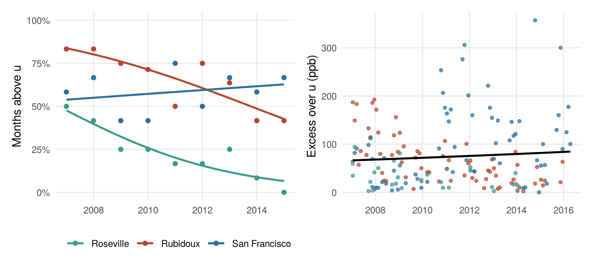

# Extreme Nitric Oxide Pollution in California, 2007–2016

Did the months with extreme nitric oxide (NO) pollution in Californian cities become rarer between 2007 and 2016, and what drives them? This project models the upper tail of monthly NO at ten monitoring sites in nine cities using peaks-over-threshold extreme value theory: a generalised Pareto distribution (GPD) for the size of each extreme month, and a binomial model for how often extremes happen.

**Read the full report:** [report.md](report.md).



*Left: share of months above the 131.2 ppb threshold each year at the three cities where nearly all extremes occur, with fitted logistic trends. Right: size of each exceedance over time; the black line is the fitted mean excess, which is close to flat.*

## Findings

- **Defining an extreme.** The 85th percentile, 131.2 ppb, is supported by the mean residual life and parameter-stability plots and leaves 161 extreme site-months. Pooled across sites, the GPD shape is ξ = −0.11 (95% CI −0.25 to 0.04), so the data cannot say whether the tail is bounded.
- **Extremes became rarer, but not smaller.** The fitted chance that a month is extreme fell from 0.84 to 0.43 at Rubidoux and from 0.48 to 0.07 at Roseville between 2007 and 2015 (odds ratios 0.79 and 0.73 per year, both p < 0.01). San Francisco shows no trend. There is no evidence that the size of exceedances changed (p = 0.32).
- **Season matters, the weather variables do not.** Extreme months cluster in autumn and winter, and are larger then: a seasonal cycle in the GPD scale, peaking in November–December, improves the fit (p = 0.005). Temperature, wind speed and pressure do not improve the model, with or without season (likelihood ratio p from 0.17 to 0.63), and multiple imputation of the missing weather data does not change this.
- **Cities differ in level, not in tail shape.** Nearly all extreme months occur at Rubidoux, San Francisco and Roseville. Within one GPD, San Francisco's exceedances are typically 1.6 times as large as Rubidoux's, and Roseville's about half as large (p < 0.001). Allowing a different shape for each city does not improve the fit, against a common threshold (p = 0.60) or each city's own 85th percentile (p = 0.14). Once the cities' different scales are allowed for, the shape at the three main cities is ξ = −0.34 (−0.48 to −0.19), so their tail is bounded.
- **Checks.** Quantile plots for the three main models lie almost entirely within their 95% bands. Extreme months come in runs (a month after an extreme month is itself extreme 74% of the time, against 30% overall), so confidence intervals are somewhat too narrow; refitting to one value per run gives a similar shape estimate. Site-to-site correlation is weak and unrelated to distance.

## About this project

This is my extended re-analysis of a group project for an environmental statistics course at the University of Glasgow (2026). My sections of the original report were the threshold selection, the city-level covariate models for Rubidoux and Roseville, the city-specific thresholds and the limitations. The report here is my own work: it reworks the whole analysis in response to the marker's feedback. The main changes are:

- The trend is modelled per city, separating how often extremes occur (binomial) from how large they are (GPD with a time trend), instead of a straight line fitted to yearly counts.
- Each weather variable is tested on every month in which it is measured, with a city effect and multiple imputation, instead of only the 232 months where all three are present.
- Claims about bounded and unbounded tails in my original sections are corrected, because their confidence intervals include zero.
- Cities are compared within one model, and the local thresholds are checked with city-level mean residual life plots.
- Model diagnostics, a dependence check (declustering) and a spatial check are added.

My original scripts are kept in `R/my_contribution/` for comparison.

## Files

```
report.qmd                    Quarto source: all analysis code and text
report.md                     The report, rendered for GitHub
report_files/                 Figures used by report.md
data/california_no_monthly.csv
R/my_contribution/            My original scripts for the group report
```

## How to run

```r
install.packages(c("dplyr", "tidyr", "ggplot2", "patchwork", "scales",
                   "extRemes", "mice", "knitr"))
```

Then, from the repository root, render the report with [Quarto](https://quarto.org):

```bash
quarto render report.qmd --to gfm    # writes report.md and its figures
```

The imputation step uses a fixed seed, so the numbers should match the report.

## Data

`data/california_no_monthly.csv` holds a monthly NO concentration (ppb) for each of ten monitoring sites, with monthly averages of wind speed, outdoor temperature and barometric pressure, supplied for the course. The file runs from 2002; the analysis uses 2007–2016, and the NO record ends in April 2016. The units of the weather variables are not documented.

## References

- Coles, S. (2001). *An Introduction to Statistical Modeling of Extreme Values*. Springer.
- Gilleland, E. and Katz, R. W. (2016). extRemes 2.0: An extreme value analysis package in R. *Journal of Statistical Software*, 72(8). https://doi.org/10.18637/jss.v072.i08
- van Buuren, S. and Groothuis-Oudshoorn, K. (2011). mice: Multivariate imputation by chained equations in R. *Journal of Statistical Software*, 45(3). https://doi.org/10.18637/jss.v045.i03
