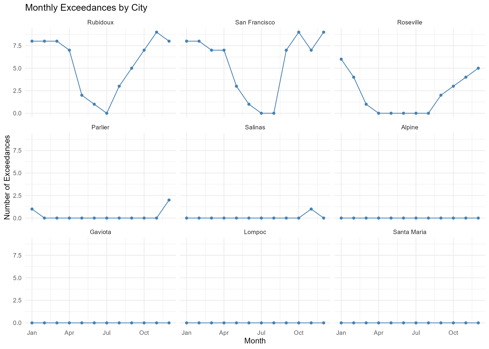

# Extreme-Value Analysis of Nitric Oxide Pollution in California

How often do extreme nitric oxide (NO) levels occur in Californian cities, are they becoming less frequent, and does one definition of "extreme" work for every city? This project applies peaks-over-threshold extreme-value modelling to 1,200 monthly maximum NO readings from ten monitoring sites in nine cities, 2007–2016.

**Group project** (four students), University of Glasgow, 2026. The section below says which parts are mine.



*Exceedances of the global 131.18 ppb threshold by month. Three cities account for nearly all of them, all with a winter peak; five cities never exceed it.*

## Findings

- **Threshold.** The 85th percentile, 131.18 ppb (161 exceedances), was chosen as the global threshold for "extreme". It sits in the region where the mean residual life plot is approximately linear and the generalised Pareto (GPD) parameters are stable, while leaving enough exceedances for reliable estimation. The fitted shape parameter (ξ ≈ −0.20) points to a bounded upper tail.
- **Trend.** Annual exceedance counts fell by about 1.2 events per year (p = 0.018) between 2007 and 2015.
- **Drivers.** Seasonality was the main driver of exceedance severity. Temperature, wind speed and pressure did not significantly improve the models.
- **One threshold does not fit all cities.** Under the global threshold, five of the nine cities had no exceedances at all. City-specific 85th percentile thresholds, ranging from 24.0 ppb in Gaviota to 279.3 ppb in San Francisco, gave every city 15–17 exceedances and showed that tail behaviour differs: Rubidoux and Roseville have bounded tails, while Alpine and Gaviota have unbounded ones (ξ̂ = 0.161 and 0.387), which the single global model hides.
- **Limitations.** Weather covariates had heavy missingness (pressure missing for 72% of observations), and San Francisco's temperature sensor was missing on its most polluted days, so its extreme events dropped out of every covariate model.

## My contribution

The group split the analysis by question. My parts were:

- **Threshold selection (Q1):** candidate thresholds, mean residual life and parameter-stability diagnostics, and the choice of the 85th percentile threshold that the rest of the analysis builds on.
- **City-level covariate models (part of Q4):** GPD models with seasonal and temperature terms for Rubidoux and Roseville, showing seasonality as the main driver, and identifying San Francisco's missing temperature records as a source of bias.
- **Improving estimation (Q5):** city-specific thresholds and the city-by-city GPD fits.
- **Limitations section:** linking the city-level constraints back to the missing-data and sparse-exceedance problems found earlier.

My own scripts are in `R/my_contribution/`. `R/group_analysis.R` is the combined script the group used for the final report, which includes everyone's sections.

## How to run

```r
install.packages(c("tidyverse", "extRemes", "lubridate", "knitr", "cowplot",
                   "forecast", "broom", "xtable", "mapview", "sf"))

# from the repository root
source("R/group_analysis.R")                             # full group analysis
source("R/my_contribution/thresholds_and_city_models.R") # my sections
```

Figures and LaTeX tables are written to `plots/`.

## Data

`data/california_no_monthly.csv`: monthly maximum NO concentration (ppb) with monthly average wind speed, temperature and pressure for ten Californian monitoring sites, supplied for the course. The file runs from 2002; the analysis uses 2007–2016.

## Files

```
R/group_analysis.R                              Combined group analysis
R/my_contribution/q1_threshold_selection.R      Threshold selection (Q1)
R/my_contribution/thresholds_and_city_models.R  Q1 set-up, city-level models (Q4), city-specific thresholds (Q5)
data/california_no_monthly.csv                  Monitoring data
figures/                                        Selected figures from my sections
```
