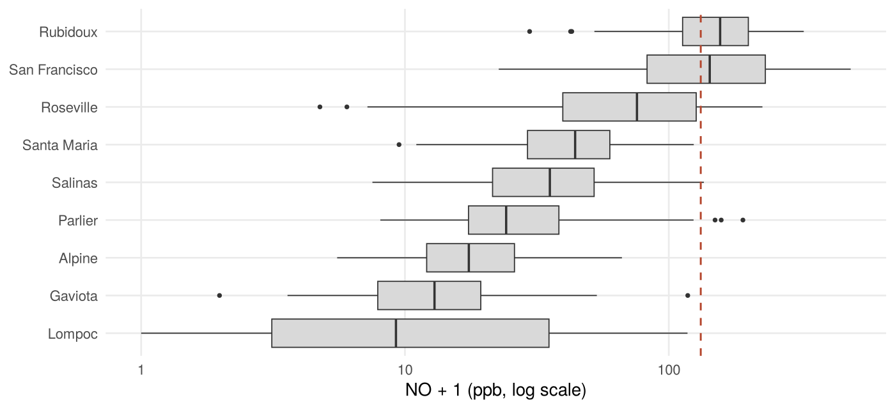
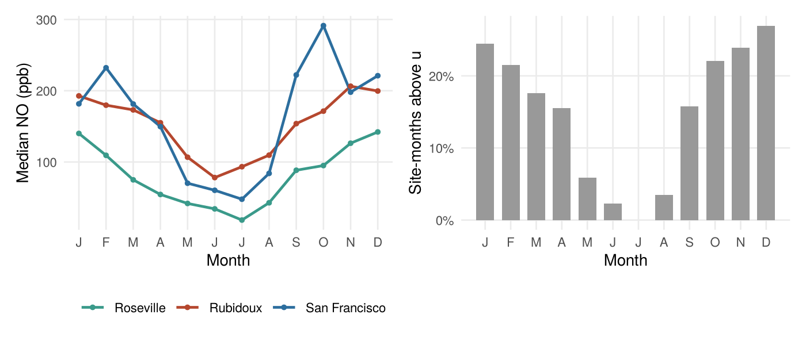
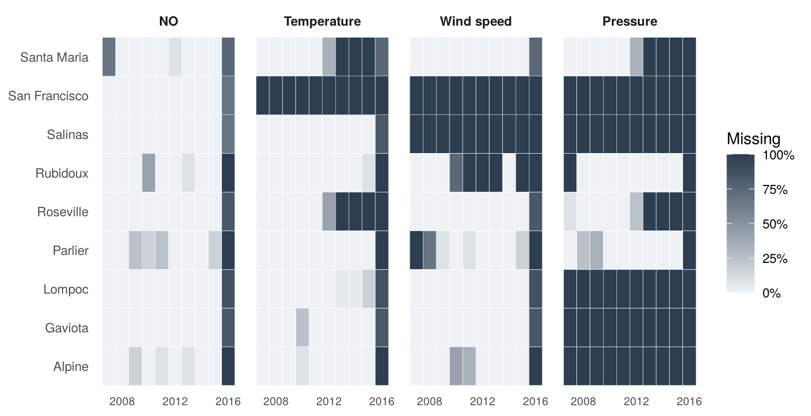
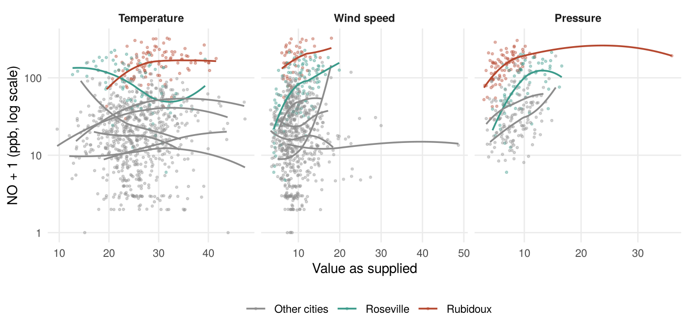
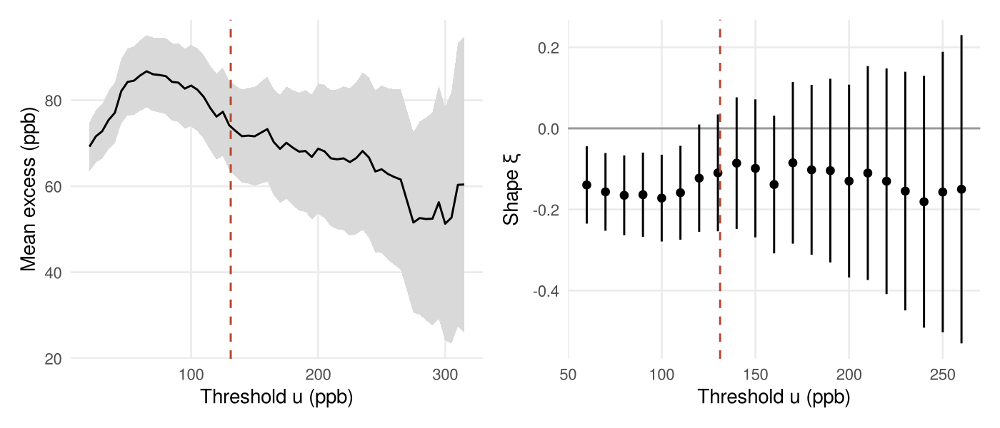
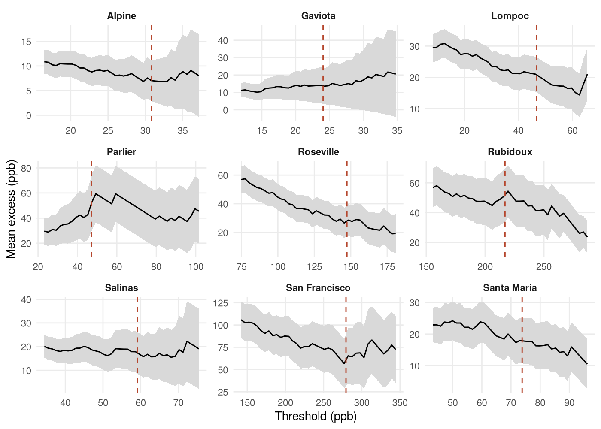
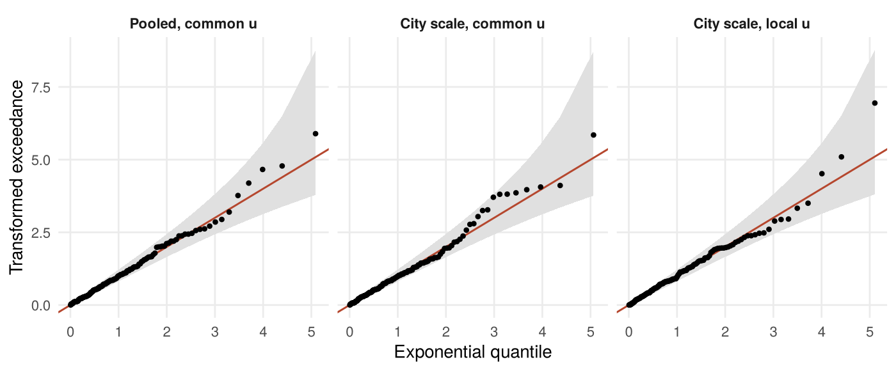

# Extreme Nitric Oxide Pollution in California, 2007–2016
Ahmed Mohamed
October 2026

## Introduction

Nitric oxide (NO) and nitrogen dioxide (NO2), together called
NOx, are the main nitrogen oxides in polluted air. They
convert rapidly into each other. NO2 is the more directly
harmful and is regulated by the US Environmental Protection Agency
through its National Ambient Air Quality Standards (EPA 2023). NO itself
is not regulated, so there are no official baseline or extreme levels.
Because NO is a precursor of NO2, its extremes still matter
for exposure. Most NO comes from combustion, so it is highest in urban
and industrial areas, and wildfires add occasional spikes (Perring et
al. 2026).

This report studies the *extremes* of NO: the rare months with very high
concentrations, rather than typical levels. It asks four questions:

1.  **Definition.** What counts as an extreme NO month in these data,
    and what does the upper tail look like?
2.  **Time.** Did extreme months become less frequent, or less severe,
    between 2007 and 2016?
3.  **Weather and season.** Do temperature, wind speed, barometric
    pressure or the time of year change how severe extremes are?
4.  **Cities.** How do extremes differ between cities, both against one
    common threshold (a *global* definition of extreme) and against each
    city’s own threshold (a *local* definition)?

**Why extreme value theory.** Ordinary models, such as a regression on
the mean, describe the bulk of the data and fit it best where most
observations lie. Extremes are, by definition, scarce, and they sit in
the tail where those models are least reliable. Extreme value theory
(EVT) gives a model justified for the tail itself. The result used here
(Pickands, Balkema and de Haan) says that, for a wide class of
distributions, the amounts by which observations exceed a sufficiently
high threshold $u$ approximately follow a generalised Pareto
distribution (GPD), whatever the distribution of the bulk. The approach
of modelling every value above $u$ is called peaks over threshold (POT).
It uses more of the data than the alternative of keeping one maximum per
year (block maxima), which matters with only ten years of records.

**About this report.** This is an extended re-analysis of a group
project for an environmental statistics course at the University of
Glasgow (2026). My sections of the original report were the threshold
selection, the city-level covariate models for Rubidoux and Roseville,
the city-specific thresholds and the limitations. This version is my own
work. It reworks the whole analysis in response to the marker’s
feedback, and corrects several claims in my original sections that the
data do not support.

## Data and exploratory analysis

The data contain one NO concentration (ppb) per site and month for ten
monitoring sites in nine Californian cities (Lompoc has two sites), from
January 2007 to December 2016: 1200 site-months in total. Monthly
averages of wind speed, outdoor temperature and barometric pressure are
also given. Their units are not documented, and their values do not
follow the usual seasonal pattern for these places, so weather effects
below are reported per unit of the variable as supplied. NO is observed
in 1069 site-months. Only 18 of them fall in 2016, all in January to
April, so the 2016 record is incomplete.

NO is strongly right-skewed: the median is 32.3 ppb, the mean 60.5 ppb
and the maximum 488.2 ppb.
<a href="#fig-cities" class="quarto-xref">Figure 1</a> shows that three
cities, Rubidoux, San Francisco and Roseville, have far higher
concentrations than the other six, and
<a href="#fig-season" class="quarto-xref">Figure 2</a> shows a strong
seasonal cycle, with high values from October to February.

Figure 1: Monthly NO concentration by city, 2007–2016, on a log scale.
The dashed line is the global threshold u defined below.

Figure 2: Seasonal cycle. Monthly NO at the three cities where most
extreme months occur (lines are monthly medians), and the share of all
observed site-months above the global threshold u.

### Missing data

Figure 3: Share of months missing for each variable, by city and year.
Most gaps are structural: a variable is never measured at a site, or
measurement stops.

The weather variables have many gaps: 310 of 1200 months are missing for
temperature, 416 for wind speed and 867 for pressure.
<a href="#fig-missing" class="quarto-xref">Figure 3</a> shows that the
gaps are not scattered at random. They are mostly **structural**:

- San Francisco never records any weather variable, Salinas never
  records wind or pressure, and pressure is only measured at four sites.
- Temperature and pressure stop at Roseville and Santa Maria in 2012.
- 2016 is missing almost entirely, because the record ends in April.

This pattern can bias any analysis that uses only complete rows. NO fell
over the decade, so months with missing weather data are
disproportionately recent, low-pollution months. At Roseville, for
example, the median NO is 95.7 ppb in months with a temperature reading
and 58.0 ppb in months without one. San Francisco is the clearest case:
it has 66 extreme months, but none of them can enter a model that needs
a weather variable.

The original group analysis made this worse by fitting every weather
model on the rows where *all three* weather variables were present. That
left 232 site-months with 46 extreme months. Here each variable is
tested on all the months where it is measured, and multiple imputation
is tried for temperature and wind speed (see *Season and weather*).

### Weather variables

Figure 4: NO against each weather variable for the cities that record
it, with a smoothed trend per city (log scale). Within cities the
relationships are weak and not clearly linear.

<a href="#fig-covariates" class="quarto-xref">Figure 4</a> plots NO
against each weather variable. Most of the variation is between cities:
the polluted cities sit high whatever the weather. Within a city the
smoothed trends are mostly flat or gently curved, with no strong linear
relationship. This motivates two choices in the weather models below:
every weather model includes a city effect, so that a weather variable
is not credited with what are really differences between places, and any
weather effect is expected to be small.

## Defining an extreme month

A threshold must be high enough that the GPD approximation holds above
it, but low enough to leave enough exceedances to estimate the model:
too low gives bias, too high gives noisy estimates. Two standard plots
guide the choice
(<a href="#fig-threshold" class="quarto-xref">Figure 5</a>). Above a
valid threshold, the mean excess $\mathrm{E}(X-u \mid X>u)$ is a linear
function of $u$, so the mean residual life (MRL) plot should be
straight. The shape $\xi$ and the modified scale
$\sigma^{*}=\sigma_u-\xi u$ should also stay constant. The MRL plot is
roughly linear from about 120 ppb, and both parameters are stable from
about 100 ppb, with widening intervals above 200 ppb.

Figure 5: Threshold choice. Left: mean residual life plot with 95%
intervals. Right: GPD shape estimate against threshold with 95%
intervals. The vertical line marks the chosen threshold, the 85th
percentile.

The threshold is set at the 85th percentile, $u =$ 131.18 ppb. It sits
in the stable region of both plots and leaves 161 exceedances (15.1% of
observed site-months). The fitted GPD has scale $\hat\sigma =$ 81.9 ppb,
95% CI (64.6, 99.2), and shape $\hat\xi =$ -0.108, 95% CI (-0.254,
0.038).

The interval for $\xi$ includes zero. So the pooled data do not
establish whether the tail is bounded ($\xi<0$) or decays exponentially
($\xi=0$). My original section stated $\xi\approx-0.20$ and concluded
that the tail was bounded, which the uncertainty does not support. The
diagnostic plots in
<a href="#fig-diagnostics" class="quarto-xref">Figure 8</a> (left) show
a good fit. With about 120 site-months per year, the model’s 2-year and
10-year return levels are 374.7 and 456.8 ppb. These are the levels
expected to be exceeded at some site about once in 2 and 10 years
respectively.

**Dependence.** Extreme months come in runs. Given that a site exceeded
$u$ last month, it exceeds it this month with probability 0.74, against
0.30 at the same sites overall. The 161 exceedances form 46 runs of
consecutive months. The GPD theory assumes independent exceedances.
Refitting to the largest value in each run (declustering) gives
$\hat\xi =$ -0.040, CI (-0.373, 0.292). The estimate is similar, but the
interval is wider. The models below use all exceedances, so their
confidence intervals should be read as somewhat too narrow.

## Has extreme pollution changed over time?

The original report fitted a straight line to the number of exceedances
per year. That gave a slope of -1.2 exceedances per year (95% CI -2.1 to
-0.3), but it treated counts as continuous, ignored that different
cities contribute, and was not an extreme value model. Here the two
parts of a POT model are analysed separately: **how often** a site-month
exceeds $u$, and **by how much** when it does.

**Frequency.** For each of the three cities where nearly all extreme
months occur, the number of exceedances in each full year (2007–2015) is
modelled as binomial out of the months observed, with a logistic trend
in year. A quasi-binomial fit estimates the dispersion. All three
dispersion estimates are below 1 (0.45, 0.73, 0.48), so the yearly
counts vary no more than a binomial model allows. A Poisson model for
the counts, as used in the original city comparison, was never checked
and is less natural here, because a site can exceed $u$ at most 12 times
a year. The trend differs between cities ($F$-test for different slopes,
$p$ \< 0.001), so <a href="#tbl-trend" class="quarto-xref">Table 1</a>
reports one per city.

Table 1: Trend in the frequency of extreme months, 2007–2015. The odds
ratio is the multiplicative change per year in the odds that a month
exceeds u; P(exceed) is the fitted probability.

| City          | Odds ratio |     95% CI     | p-value | P(exceed) 2007 | P(exceed) 2015 |
|:--------------|:----------:|:--------------:|:-------:|:--------------:|:--------------:|
| Rubidoux      |   0.785    | (0.685, 0.899) |  0.004  |      0.84      |      0.43      |
| San Francisco |   1.047    | (0.898, 1.220) |  0.502  |      0.54      |      0.63      |
| Roseville     |   0.726    | (0.614, 0.859) |  0.003  |      0.48      |      0.07      |

Figure 6: Left: share of observed months above u each year, with the
fitted logistic trend. Right: size of every exceedance over time,
coloured as on the left (grey: other cities); the line is the fitted GPD
mean excess under the time-trend model, which is close to flat.

Extreme months became much rarer at Rubidoux and Roseville. At Rubidoux
the fitted chance that a month exceeds $u$ fell from 0.84 in 2007 to
0.43 in 2015, and at Roseville from 0.48 to 0.07. San Francisco shows no
trend: odds ratio 1.047, CI (0.898, 1.220).

**Severity.** The GPD scale is allowed to change with time,
$\log\sigma(t)=\phi_0+\phi_1 t$, with $t$ in years from 2011. The
estimated change is $\hat\phi_1 =$ 0.026 per year, 95% CI (-0.024,
0.076), which is about 2.6% per year. The likelihood ratio test against
a constant scale gives $p$ = 0.320, and after allowing for season $p$ =
0.404. There is no evidence that exceedances became smaller.

**Answer to question 2.** Between 2007 and 2015, extreme NO months
became less *frequent* at Rubidoux and Roseville but not at San
Francisco. When an extreme month did occur, it was no less *severe* than
before.

## Season and weather

Each weather variable enters the GPD scale on the log scale,
$\log\sigma=\text{city effect}+\beta x$, using every month in which it
is measured. Only cities with at least ten exceedances are included,
which leaves Rubidoux and Roseville in each case. San Francisco has no
weather data, and the other cities have too few extreme months. Each
model is compared by a likelihood ratio test with the same model without
the variable, with and without seasonal terms.

Table 2: Weather variables in the GPD scale, with a city effect. $\beta$
is the change in log-scale per unit of the variable as supplied, and
$\exp(\beta)-1$ is the percentage change in the typical size of an
exceedance per unit. p is from the likelihood ratio test; p (season)
repeats it with seasonal terms in both models.

| Variable    | Exceedances |    $\beta$ (95% CI)    | % change |   p   | p (season) |
|:------------|:-----------:|:----------------------:|:--------:|:-----:|:----------:|
| Temperature |     86      | -0.014 (-0.039, 0.012) |  -1.3%   | 0.455 |   0.296    |
| Wind speed  |     60      |  0.025 (0.004, 0.046)  |   2.5%   | 0.169 |   0.322    |
| Pressure    |     75      | 0.012 (-0.037, 0.062)  |   1.2%   | 0.627 |   0.096    |

None of the three weather variables improves the model, with or without
season (<a href="#tbl-weather" class="quarto-xref">Table 2</a>). The
original report described pressure as “near significant”, but that came
from the restricted complete-row data without a city effect. With a city
effect and all months in which pressure is measured, the estimate is
0.012 per unit (CI (-0.037, 0.062)). That interval runs from a 3.7%
decrease to a 6.3% increase in the typical size of an exceedance per
unit of pressure, so the data cannot tell whether pressure has any
effect on extreme pollution. For wind speed the Wald interval just
excludes zero, but the likelihood ratio test, which is more reliable in
samples this small, does not support an effect.

**Imputation.** Temperature and wind speed were imputed 20 times by
predictive mean matching (`mice`), using city, time, season, NO and the
other variable, at every site that records them at least sometimes.
Pooled with Rubin’s rules, the temperature effect is -0.014 (CI (-0.048,
0.020)) and the wind effect 0.041 (CI (-0.011, 0.094)). These are close
to the complete-data results. Imputation adds only a handful of extreme
months, because most missing extreme months are in San Francisco, which
never measures weather and so cannot be imputed from its own record.

**Season** matters, unlike the weather variables. With a city effect for
the three main cities, adding a yearly cycle ($\sin$ and $\cos$ of
month) to the log-scale improves the fit, $p$ = 0.005. The cycle peaks
between November and December, and changes the typical exceedance size
by a factor of up to 1.44 above or below the average. Season is
therefore the main driver found of extreme NO, both of how often
extremes happen (<a href="#fig-season" class="quarto-xref">Figure 2</a>)
and of how large they are. The supplied weather variables do not explain
it.

## Differences between cities

### Against a common threshold

With one threshold for all cities, the question is about absolute
levels: where do concentrations above 131.2 ppb occur?
<a href="#tbl-rates" class="quarto-xref">Table 3</a> shows that the
answer is almost entirely in three places. Six cities have at most three
extreme months in ten years. That is a finding in its own right, not
missing information: it says their NO stays well below the levels seen
at Rubidoux, San Francisco and Roseville.

Table 3: Share of observed months above the global threshold u, with
exact 95% binomial intervals.

| City          | Months observed | Months above u |  Share (95% CI)   | Maximum (ppb) |
|:--------------|:---------------:|:--------------:|:-----------------:|:-------------:|
| Rubidoux      |       102       |       66       | 0.65 (0.55, 0.74) |     323.8     |
| San Francisco |       112       |       66       | 0.59 (0.49, 0.68) |     488.2     |
| Roseville     |       110       |       25       | 0.23 (0.15, 0.32) |     225.4     |
| Parlier       |       98        |       3        | 0.03 (0.01, 0.09) |     190.0     |
| Salinas       |       112       |       1        | 0.01 (0.00, 0.05) |     134.8     |
| Alpine        |       104       |       0        | 0.00 (0.00, 0.03) |     65.4      |
| Gaviota       |       110       |       0        | 0.00 (0.00, 0.03) |     117.0     |
| Lompoc        |       219       |       0        | 0.00 (0.00, 0.02) |     116.8     |
| Santa Maria   |       102       |       0        | 0.00 (0.00, 0.04) |     123.4     |

The original report compared Rubidoux and Roseville with a Poisson test.
Here the three cities with enough exceedances are compared within one
GPD, with city as a covariate in the scale:
$\log\sigma=\phi_0+\phi_{\text{city}}$. Taking Rubidoux as the
reference, San Francisco’s exceedances are larger by a factor of 1.62
(CI (1.30, 2.01)). Roseville’s are smaller by a factor of 0.49 (CI
(0.36, 0.66)). The city effect is clear ($p$ \< 0.001). Letting the
shape also differ by city does not improve the fit ($p$ = 0.600).

With a common shape and a city-specific scale, $\hat\xi =$ -0.338, CI
(-0.483, -0.192). Once the different scales of the three cities are
allowed for, the interval excludes zero, so at these cities the tail
above 131.2 ppb is bounded. Pooling cities with different scales, as in
the single fit used to define extremes, mixes them together and makes
the tail look heavier than it is at any one city.

### Against each city’s own threshold

Figure 7: Mean residual life plot for each city, with 95% intervals. The
dashed line is the city’s 85th percentile, used as its local threshold.

A local threshold asks a different question: when is a month extreme
*for that city*? Each city’s 85th percentile ranges from 24.0 ppb to
279.3 ppb and leaves 15 to 17 exceedances per city (33 for Lompoc, which
has two sites). The marker asked for evidence that the 85th percentile
suits each city.
<a href="#fig-mrl-city" class="quarto-xref">Figure 7</a> shows the city
MRL plots. Most are roughly linear around their threshold, but with so
few points per city the intervals are wide, and the plots cannot pin the
threshold down precisely.

My original section fitted a separate GPD to each city and reported that
Alpine and Gaviota have unbounded tails while Rubidoux and Roseville
have bounded ones. With intervals added, that claim does not hold. Every
other city’s 95% interval for $\xi$ includes zero, and the Rubidoux fit
($\hat\xi =$ -1.14) breaks down, because the GPD estimates become
unreliable when $\xi<-1$. A single model with a city-specific scale and
a common shape fits as well as one with nine separate shapes ($p$ =
0.137). Its shape is $\hat\xi =$ -0.031, CI (-0.197, 0.134).

**Answer to question 4.** The cities differ enormously in the *level* of
their extremes: how often they pass a common threshold, and the scale of
their exceedances. There is no evidence that the *shape* of their tails
differs.

### Spatial dependence

The original group code mapped site means and found no geographical
pattern beyond the urban sites being higher. As a direct check, monthly
log-NO at each site was deseasonalised, and the correlation between
every pair of sites was compared with the distance between them.
Correlations are weak (median 0.12) and unrelated to distance (Spearman
$\rho =$ 0.18, $p =$ 0.244). So there is no evidence of spatial
dependence that the models above need to account for.

## Model checks

Figure 8: Quantile plots for three GPD models, after transforming each
exceedance to a standard exponential scale using its own fitted
parameters. The grey band is a pointwise 95% range for a correct model.
Left: pooled model used to define extremes. Centre: common threshold
with city-specific scale. Right: local thresholds with city-specific
scale and common shape.

The original report showed no diagnostics for its GPD fits.
<a href="#fig-diagnostics" class="quarto-xref">Figure 8</a> checks the
three main models on a common scale. Each exceedance is transformed with
its own fitted scale and shape, so that a correct model gives standard
exponential values. Almost every point lies inside the 95% band: 0 of
161 exceedances fall outside it for the pooled model, 0 of 157 for the
city-scale model at the common threshold and 3 of 164 for the
local-threshold model. The largest few values sit above the line in each
panel, so the models may slightly understate the very highest months,
but not beyond what chance allows.

## Discussion

**Two definitions of an extreme.** This report uses two definitions, and
they answer different questions.

- **A common threshold** is an absolute definition. It is the relevant
  one for exposure and regulation: a month above 131.2 ppb is a
  high-pollution month wherever it occurs. Under it, extremes are
  concentrated in three cities. The other six rarely or never reach that
  level, which shows that they are cleaner, not that their data are
  deficient.
- **A local threshold** is relative. It asks whether a city is having an
  unusually bad month by its own standards, which can matter for local
  warnings even in a clean city. Under it, every city has extremes by
  construction, and the comparison is about their *shape*.

The two views agree on the main point. Cities differ in the level of
their extremes, not detectably in the shape of their tails.

**Conclusions.**

- An 85th-percentile threshold of 131.2 ppb is supported by the MRL and
  stability plots.
- Pooled across sites, the shape of the tail cannot be distinguished
  from zero. Once the different scales of the three polluted cities are
  allowed for, their tail is bounded.
- Extreme months became markedly less frequent at Rubidoux and Roseville
  between 2007 and 2015, and did not change at San Francisco. Their
  severity showed no change over time.
- Season is the clearest driver of both the frequency and the size of
  extremes. The supplied temperature, wind and pressure variables add
  nothing once city and season are accounted for, and multiple
  imputation does not change this.
- Cities differ strongly in the level of their extremes. With about 16
  exceedances per city, there is no evidence that their tail shapes
  differ.

**Limitations.**

- **Dependence.** Exceedances cluster in consecutive months. The models
  treat them as independent, so their confidence intervals are somewhat
  too narrow. The declustered fit gives similar estimates with wider
  intervals.
- **Missing data.** The weather analysis rests on two cities, because
  San Francisco, the city with the largest exceedances, records no
  weather at all. Imputation cannot recover a variable a site never
  measures.
- **Data size.** City-level models at local thresholds have about 16
  exceedances each, which is enough to estimate a scale but not a
  separate shape for each city.
- **Covariate units.** The units of the weather variables are
  undocumented and their seasonal patterns are unusual, so their
  estimated effects are per unit as supplied.
- **Pooling.** One threshold is shared across sites with very different
  levels. The city comparison handles this with city effects, but the
  pooled fit used to define extremes averages over these differences.

**Further work.** A natural next step is a point-process model with a
site-specific threshold, which would model frequency and size together.
Declustering within each site, and linking extreme months to wildfire
records, would also help.

## References

EPA (2023). *NAAQS Table*. United States Environmental Protection
Agency. <https://www.epa.gov/criteria-air-pollutants/naaqs-table>.

Coles, S. (2001). *An Introduction to Statistical Modeling of Extreme
Values*. Springer.

Gilleland, E. and Katz, R. W. (2016). extRemes 2.0: An extreme value
analysis package in R. *Journal of Statistical Software*, 72(8), 1–39.
<https://doi.org/10.18637/jss.v072.i08>.

Perring, M. P. et al. (2026). Nitric oxide (NO) and nitrogen dioxide
(NO2): A state-of-knowledge review of their roles in, and
consequences for, vegetation and ecosystems. *Atmospheric Environment*,
367. <https://doi.org/10.1016/j.atmosenv.2025.121744>.

van Buuren, S. and Groothuis-Oudshoorn, K. (2011). mice: Multivariate
imputation by chained equations in R. *Journal of Statistical Software*,
45(3), 1–67. <https://doi.org/10.18637/jss.v045.i03>.
